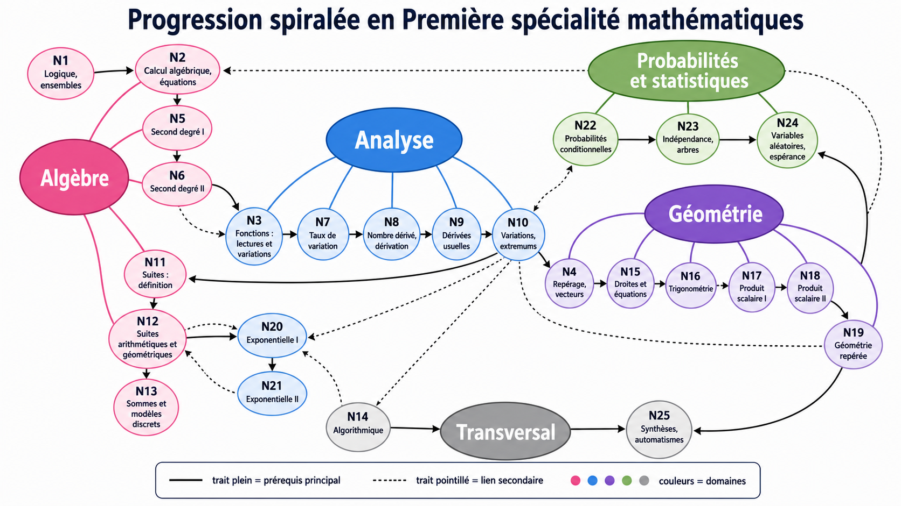

# Progression visuelle

La carte ci-dessous montre les notions de Première spécialité mathématiques, regroupées par domaine, et leurs liens : prérequis en trait plein, liens secondaires en pointillé.

## Progression calendaire

[Ouvrir la progression calendaire (PDF)](assets/documents/Progression_calendrier.pdf)

## Carte de progression

**Cliquez sur une bulle pour ouvrir la page de la notion.**

<!-- CARTE-PROGRESSION:DEBUT -->

<button type="button" class="carte-fermer" aria-label="Fermer la carte agrandie">✕ Fermer</button>

[N01 – Logique, ensembles](notions/N01-logique-ensembles.md){.bulle-progression style="left:3.17%;top:9.56%;width:7.12%;height:9.78%" title="N01 – Logique, ensembles"}
[N02 – Calcul algébrique, équations](notions/N02-calcul-algebrique-equations.md){.bulle-progression style="left:15.13%;top:9.03%;width:9.09%;height:9.25%" title="N02 – Calcul algébrique, équations"}
[N03 – Fonctions : lectures et variations](notions/N03-fonctions-lectures-variations.md){.bulle-progression style="left:25.18%;top:41.23%;width:6.04%;height:10.84%" title="N03 – Fonctions : lectures et variations"}
[N04 – Repérage, vecteurs](notions/N04-reperages-vecteurs.md){.bulle-progression style="left:60.59%;top:51.33%;width:5.14%;height:9.25%" title="N04 – Repérage, vecteurs"}
[N05 – Second degré I](notions/N05-second-degre-i.md){.bulle-progression style="left:15.91%;top:21.04%;width:7.48%;height:8.40%" title="N05 – Second degré I"}
[N06 – Second degré II](notions/N06-second-degre-ii.md){.bulle-progression style="left:15.91%;top:32.20%;width:7.42%;height:8.18%" title="N06 – Second degré II"}
[N07 – Taux de variation](notions/N07-taux-de-variation.md){.bulle-progression style="left:33.13%;top:41.34%;width:5.44%;height:9.78%" title="N07 – Taux de variation"}
[N08 – Nombre dérivé, dérivation](notions/N08-nombre-derive-derivation.md){.bulle-progression style="left:40.43%;top:41.34%;width:6.04%;height:9.78%" title="N08 – Nombre dérivé, dérivation"}
[N09 – Dérivées usuelles](notions/N09-derivees-usuelles.md){.bulle-progression style="left:48.09%;top:41.34%;width:5.14%;height:9.78%" title="N09 – Dérivées usuelles"}
[N10 – Variations, extremums](notions/N10-variations-extremums.md){.bulle-progression style="left:54.78%;top:41.45%;width:5.50%;height:9.78%" title="N10 – Variations, extremums"}
[N11 – Suites : définition](notions/N11-suites-definition.md){.bulle-progression style="left:13.88%;top:49.63%;width:6.64%;height:8.93%" title="N11 – Suites : définition"}
[N12 – Suites arithmétiques et géométriques](notions/N12-suites-arithmetiques-geometriiques.md){.bulle-progression style="left:12.20%;top:61.32%;width:8.31%;height:11.16%" title="N12 – Suites arithmétiques et géométriques"}
[N13 – Sommes et modèles discrets](notions/N13-sommes-modeles-discrets.md){.bulle-progression style="left:12.74%;top:75.03%;width:6.94%;height:10.84%" title="N13 – Sommes et modèles discrets"}
[N14 – Algorithmique](notions/N14-algorithmique.md){.bulle-progression style="left:36.30%;top:79.81%;width:6.88%;height:9.14%" title="N14 – Algorithmique"}
[N15 – Droites et équations](notions/N15-droites-equations.md){.bulle-progression style="left:67.46%;top:51.22%;width:4.96%;height:9.35%" title="N15 – Droites et équations"}
[N16 – Trigonométrie](notions/N16-trigonometrie.md){.bulle-progression style="left:73.98%;top:52.07%;width:5.32%;height:8.50%" title="N16 – Trigonométrie"}
[N17 – Produit scalaire I](notions/N17-produit-scalaire-i.md){.bulle-progression style="left:80.98%;top:52.07%;width:4.90%;height:9.35%" title="N17 – Produit scalaire I"}
[N18 – Produit scalaire II](notions/N18-produit-scalaire-ii.md){.bulle-progression style="left:87.50%;top:52.18%;width:4.84%;height:9.46%" title="N18 – Produit scalaire II"}
[N19 – Géométrie repérée](notions/N19-geometrie-reperee.md){.bulle-progression style="left:91.63%;top:63.44%;width:6.16%;height:9.14%" title="N19 – Géométrie repérée"}
[N20 – Exponentielle I](notions/N20-fonction-exponentielle.md){.bulle-progression style="left:26.50%;top:62.17%;width:7.36%;height:8.18%" title="N20 – Exponentielle I"}
[N21 – Exponentielle II](notions/N21-exponentielle-ii.md){.bulle-progression style="left:26.50%;top:73.65%;width:7.42%;height:8.18%" title="N21 – Exponentielle II"}
[N22 – Probabilités conditionnelles](notions/N22-probabilites-conditionnelles.md){.bulle-progression style="left:61.54%;top:22.42%;width:6.88%;height:9.99%" title="N22 – Probabilités conditionnelles"}
[N23 – Indépendance, arbres](notions/N23-independance-arbres.md){.bulle-progression style="left:72.97%;top:22.64%;width:6.70%;height:9.56%" title="N23 – Indépendance, arbres"}
[N24 – Variables aléatoires, espérance](notions/N24-variables-aleatoires-esperance.md){.bulle-progression style="left:84.15%;top:22.32%;width:6.40%;height:10.63%" title="N24 – Variables aléatoires, espérance"}
[N25 – Synthèses, automatismes](notions/N25-syntheses-automatismes.md){.bulle-progression style="left:69.62%;top:79.38%;width:7.00%;height:10.95%" title="N25 – Synthèses, automatismes"}

<button type="button" class="carte-agrandir md-button">Agrandir la carte (plein écran, bulles cliquables)</button>
<!-- CARTE-PROGRESSION:FIN -->
